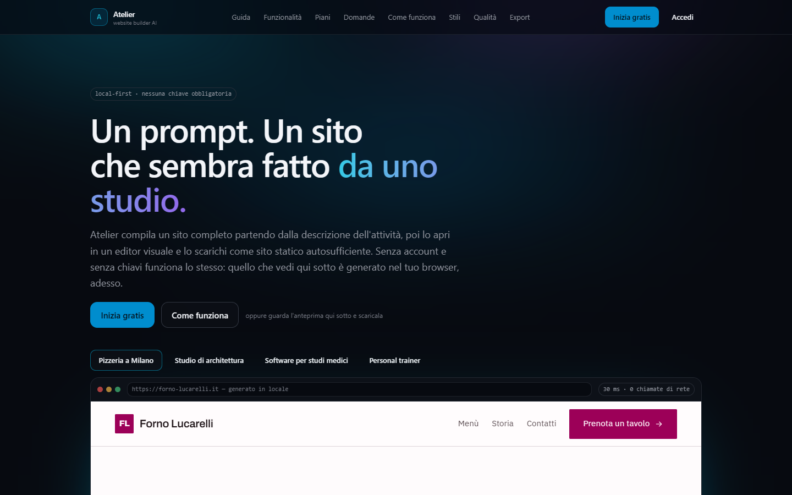
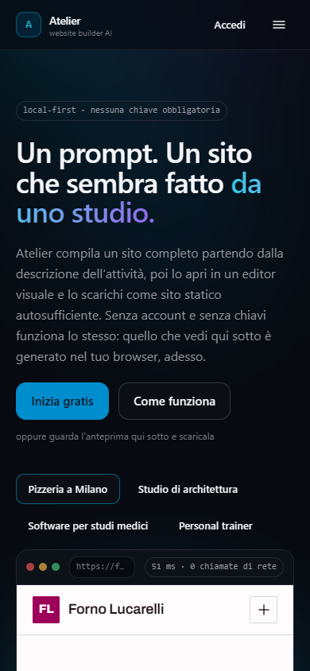
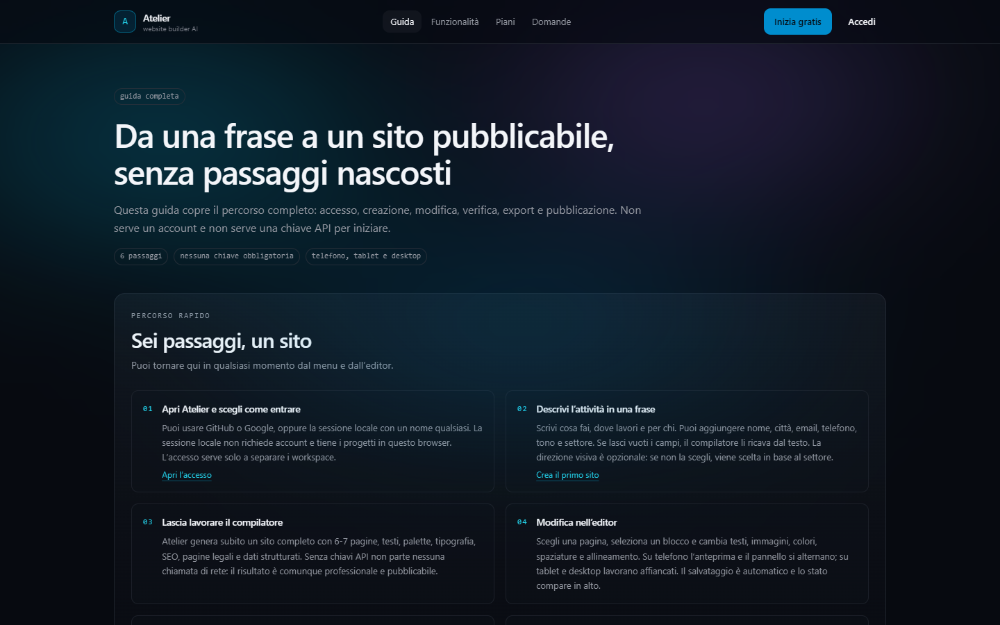
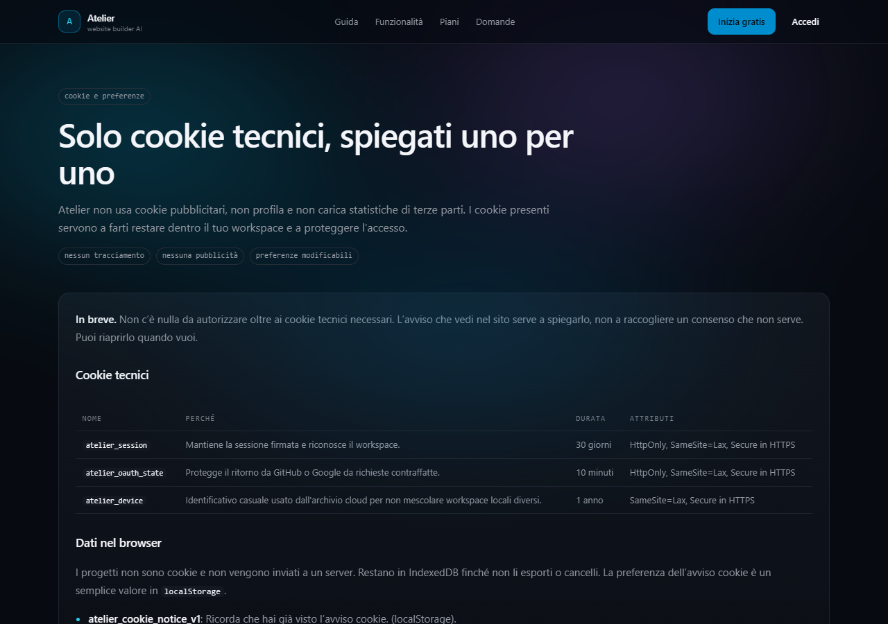
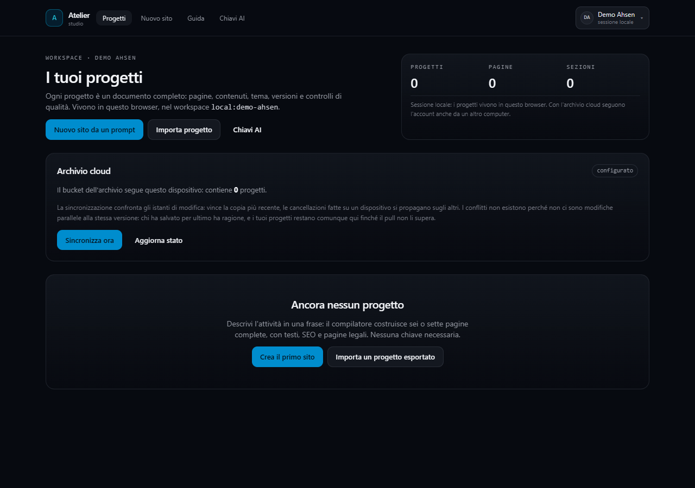
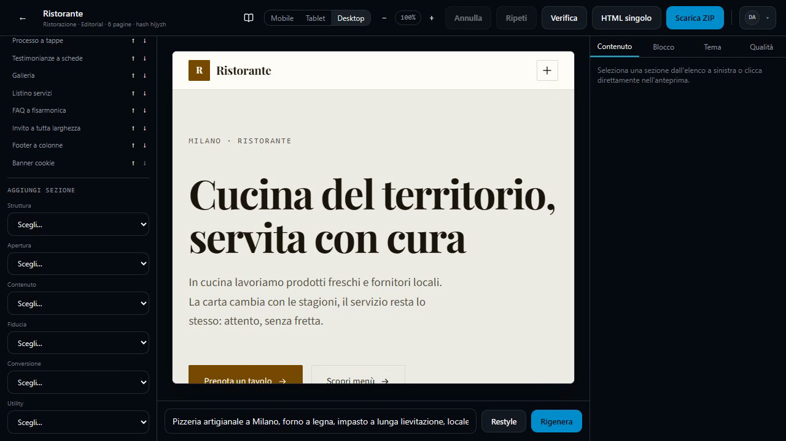
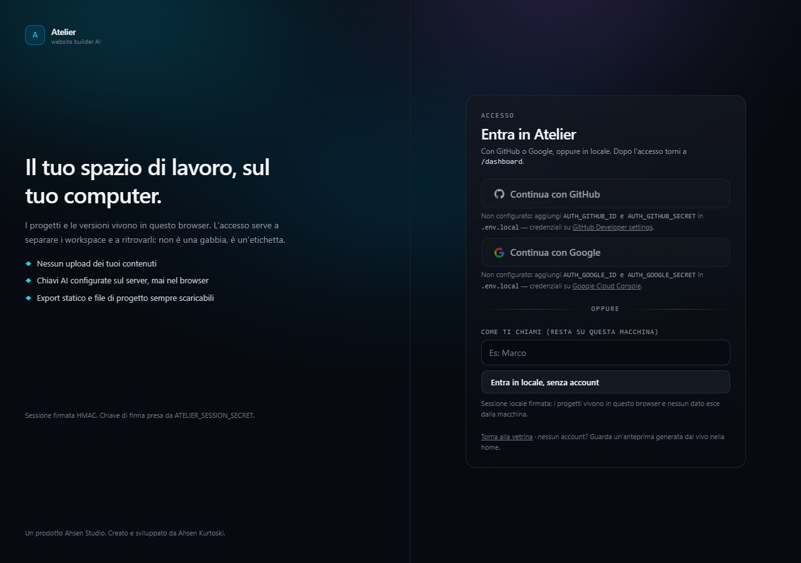
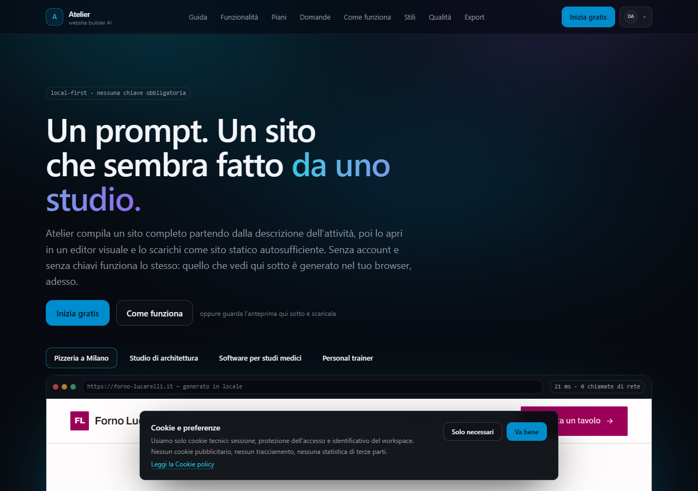

# Atelier

Website builder AI **local-first**: da un prompt a un sito completo — testi, struttura, palette, SEO e pagine legali — con editor visuale ed export statico autosufficiente.

Prodotto **Atelier** · Studio **Ahsen Studio** · Autore **Ahsen Kurtoski**.

[](docs/media/demo.mp4)

**Video demo:** [docs/media/demo.mp4](docs/media/demo.mp4) (51 s, 1280×720) — home, guida, accesso locale, generazione di un sito e Studio.

## Perché esiste

1. **Funziona sempre.** Il composer deterministico genera un sito senza rete e senza chiavi API. L'AI, quando c'è, riscrive i contenuti: la struttura e la qualità minima non dipendono da lei.
2. **Anteprima = export.** Una sola sorgente di markup (`src/lib/render/node.ts`) alimenta l'anteprima, il file HTML singolo e l'archivio statico. Non ci sono due implementazioni da tenere allineate.
3. **Zero template.** Ogni sito nasce da un brief, con controlli di unicità strutturale e di voce del settore.

## Screenshot reali

| Vetrina desktop | Telefono | Tablet |
| --- | --- | --- |
|  |  |  |

| Guida | Cookie e preferenze | Dashboard |
| --- | --- | --- |
|  |  |  |

| Studio | Accesso |
| --- | --- |
|  |  |



Gli screenshot sono catturati dall'app in esecuzione, non sono mockup. Le pagine sono state controllate a 390, 768 e 1440 px.

## Avvio

```bash
npm install
npm run dev        # http://localhost:3000
npm run verify     # typecheck + 191 test
npm run build
npm start
```

Su questa macchina il binario nativo di SWC è bloccato da una policy di sistema, quindi Turbopack non parte: `dev` e `build` usano Webpack. Dove Turbopack funziona ci sono `npm run dev:turbo` e `npm run build:turbo`.

## Cosa c'è dentro

### Percorso utente

```
/                  vetrina: promesse, stili, anteprima generata adesso nel browser
/guida             percorso completo, accesso, AI senza chiave, problemi comuni
/login             GitHub, Google oppure sessione locale (senza account)
/dashboard         progetti del workspace, archivio cloud, import/export
/nuovo             brief → compilazione a stadi → Studio
/studio/[siteId]   editor: canvas, inspector, AI, export
/impostazioni      account, riservatezza, stato dei provider AI
```

### Sito pubblico

```
/                   home con anteprima generata nel browser
/funzionalita       compilatore, gate, editor, export, limiti dichiarati
/piani              cosa è incluso, cosa costa zero, self-hosting
/domande-frequenti  20 risposte con dati strutturati FAQPage
/guida              guida operativa sempre raggiungibile
/privacy            mappa dei dati e cookie tecnici
/cookie             cookie, storage e preferenze, con riapertura del banner
/termini            uso, proprietà dei contenuti, verifiche che restano all'utente
/stato              diagnostica reale dell'istanza (noindex)
```

Header, footer, sitemap e dati strutturati leggono dall'anagrafica in `src/lib/site/pages.ts`: un link aggiunto una volta compare ovunque. L'URL canonico vive in `src/lib/util/site-url.ts` (dominio di produzione, fallback Vercel e `NEXT_PUBLIC_SITE_URL`). L'immagine social è generata da `src/app/opengraph-image.tsx`.

L'accesso non è un cancello: le pagine interne chiedono una sessione, ma la sessione può nascere in locale con un nome e una firma HMAC, senza alcun provider configurato. I progetti sono separati per workspace (`provider:id`) dentro IndexedDB; i record creati prima dell'accesso restano visibili alla sessione ospite.

Dalla dashboard un progetto si scarica in tre modi — archivio ZIP, HTML singolo, `progetto.atelier.json` — e si **reimporta** dallo stesso file: viene riletto con lo stesso schema con cui è stato scritto, quindi un file corrotto viene rifiutato con un motivo leggibile invece di entrare nell'editor.

## Accesso con GitHub o Google

Le credenziali si leggono solo dall'ambiente, mai dal client. Il flusso è OAuth 2 authorization code, scritto a mano: nessuna libreria di autenticazione, nessun database utenti.

1. Crea l'app OAuth e imposta come callback:
   - `http://localhost:3000/api/auth/github/callback`
   - `http://localhost:3000/api/auth/google/callback`
   - in produzione: `${NEXT_PUBLIC_SITE_URL}/api/auth/github/callback` (o `google`).
2. Metti le credenziali in `.env.local`:
   - `AUTH_GITHUB_ID` e `AUTH_GITHUB_SECRET`
   - `AUTH_GOOGLE_ID` e `AUTH_GOOGLE_SECRET`
3. Imposta `ATELIER_SESSION_SECRET` (almeno 16 caratteri) per firmare le sessioni fra macchine diverse.
4. Imposta `NEXT_PUBLIC_SITE_URL` al dominio pubblico; ha la precedenza anche su Vercel e va scritta prima della build. Dietro un proxy, Atelier usa `x-forwarded-proto` e `x-forwarded-host` per costruire il callback.

Se una coppia di credenziali manca, la pagina di accesso lo dice indicando il nome esatto della variabile e l'indirizzo dove crearle; il pulsante **Entra in locale** funziona comunque. L'origine pubblica del callback OAuth è coperta da `tests/auth-origin.test.ts`.

## AI senza chiave

Il composer offline genera sempre un sito completo e valido. Se in `.env.local` sono presenti una o più chiavi (Cerebras, Groq, Google, endpoint compatibili OpenAI), la pipeline a stadi riscrive i contenuti dentro lo stesso schema; ogni stadio ha una scadenza e un abort reale. Alla scadenza si consegna il sito del composer con un avviso, mai una pagina rotta.

Le chiavi restano sul server: `/api/providers/health` espone solo quali provider sono configurati, mai i valori.

## Cookie e privacy

Atelier usa **solo cookie tecnici**:

- `atelier_session` — sessione firmata HMAC, 30 giorni, `HttpOnly`, `SameSite=Lax`, `Secure` in HTTPS.
- `atelier_oauth_state` — protezione del ritorno OAuth, 10 minuti, `HttpOnly`.
- `atelier_device` — identificativo casuale usato dall'archivio cloud per non mescolare workspace locali, 1 anno.

Progetti e versioni vivono in IndexedDB; la preferenza del banner in `localStorage`. Nessun cookie pubblicitario, nessun pixel, nessuna statistica di terze parti. Il banner è informativo: **Solo necessari** e **Va bene** hanno lo stesso effetto perché non esiste un consenso opzionale da raccogliere. La pagina `/cookie` spiega ogni voce e permette di riaprire il banner.

## Archivio cloud (opzionale)

I progetti vivono nel browser e ci restano: l'archivio cloud è un'aggiunta, non un requisito. Con tre variabili in più — `SUPABASE_URL`, `SUPABASE_PUBLISHABLE_KEY`, `ATELIER_CLOUD_SECRET` — il pannello **Archivio cloud** della dashboard fa seguire i progetti al workspace fra dispositivi.

- **La sincronizzazione parte solo dal pulsante.** Nessun dato attraversa la rete senza una decisione esplicita; senza variabili il pannello resta spento e dice quali mancano.
- **Last-write-wins sull'istante di modifica**, applicato dal database con `where t.updated_at <= excluded.updated_at`: due dispositivi possono spingere in qualunque ordine senza cancellarsi il lavoro.
- **Le tombe impediscono le resurrezioni.** Una cancellazione è un istante, non un'assenza: senza di essa una sincronizzazione riporterebbe indietro il progetto eliminato altrove.
- **A parità di istante non si muove niente.** Dopo una spinta il cloud conserva lo stesso istante del documento locale.
- **L'owner non lo sceglie il client.** Un account GitHub/Google usa `github:<id>` o `google:<id>`; una sessione locale riceve dal server un identificativo di dispositivo nel cookie `atelier_device`.
- **Le tabelle non hanno un endpoint.** Vivono nello schema `atelier`, non esposto via REST: l'unica porta è la RPC `atelier_cloud_entry`, che verifica una busta HMAC-SHA256.

Lo schema completo sta in `docs/migrations/001-cloud-archive.sql` e `docs/migrations/002-cloud-entry.sql`; i passi operativi sono in `docs/DEPLOY.md`.

## Mappa del codice

| Percorso | Ruolo |
| --- | --- |
| `src/lib/render/` | albero `El` unico → HTML e React (parità anteprima/export) |
| `src/lib/design/` | OKLCH, contrasto WCAG calcolato, 8 preset, 8 coppie di font |
| `src/lib/schema/` | schema Zod del sito + 29 blocchi (`blocks/registry`) |
| `src/lib/compiler/` | composer offline, profili di settore, unicità |
| `src/lib/ai/` | catena multi-provider gratuita, quota ledger, compilazione a stadi |
| `src/lib/export/` | foglio di stile, site.js, pagine, sitemap, config deploy, ZIP |
| `src/lib/quality/` | sanitizzazione del markup e gate di qualità |
| `src/lib/auth/` | sessioni HMAC, OAuth GitHub/Google, origine callback, cookie |
| `src/lib/site/` | anagrafica pagine pubbliche, header/footer/sitemap coerenti |
| `src/components/site/` | vetrina: barra, galleria, anteprima generata dal vivo, cookie |
| `src/components/app/` | dashboard, creazione, chiavi, impostazioni |
| `src/components/studio/` | editor: canvas, inspector, aggiunta blocchi, export |

## Sicurezza e affidabilità

- **Export sicuro**: JSON-LD escapato; URL sanificati (`href/action/formaction/src`, blocco `javascript:`/`data:` non sicuri). Senza dominio omessi canonical, `og:url`/`og:image`, URL assoluti JSON-LD e `sitemap.xml` (robots senza `Sitemap`), senza inventare domini.
- **Form reali**: nessun indirizzo email inventato. Senza email/endpoint il modulo resta disabilitato con avviso; modalità Netlify con `name`, `form-name` e honeypot, campi con ID univoci.
- **API AI hardening**: controllo same-origin, rate limit in memoria, limite body e abort su disconnessione per compilazione e test provider.
- **UX robusta**: navbar mobile su tutte le varianti, skip link visibile al focus, animazioni visibili anche senza JS, riapertura preferenze cookie dal footer, conferma prima dell'eliminazione progetto, stato autosave e validazione `postMessage` dell'anteprima.
- **Un provider lento non blocca il sito.** Ogni stadio AI ha una scadenza (25 s blueprint, 20 s per pagina, 90 s in totale) e la richiesta viene annullata davvero.
- **Una risposta approssimativa non rompe niente.** Il blueprint è letto con tolleranza; i campi mancanti lasciano intatte le scelte del composer.
- **Il contratto d'errore è unico.** Le route rispondono `{ error, code, hint? }` con codici stabili (`NOT_CONFIGURED`, `VALIDATION`, `UPSTREAM_ERROR`, …).

## Dispositivi

- **Telefono (≤ 640 px):** barra dell'area di lavoro a icone, una colonna; nello Studio anteprima e pannello di modifica si alternano.
- **Tablet (640–1024 px):** due colonne nell'area di lavoro, controlli essenziali nello Studio, anteprima larga quanto lo schermo.
- **Desktop (≥ 1024 px):** editor a tre pannelli (pagine/blocchi, canvas, inspector) con dispositivo e zoom.

## Test

191 test in 10 file:

- `tests/parity.test.ts` — anteprima React e HTML esportato, nodo per nodo.
- `tests/composer.test.ts` — determinismo, unicità, contrasto, voce del settore.
- `tests/export.test.ts` — export autosufficiente e sanitizzazione.
- `tests/gates.test.ts` — gate di qualità e sicurezza del markup.
- `tests/pipeline.test.ts` — scadenze degli stadi AI, abort e blueprint tollerante.
- `tests/cloud-sign.test.ts` / `tests/cloud-plan.test.ts` — busta firmata, sincronizzazione, tombe.
- `tests/port.test.ts` — brief di stile, contratto API, sessioni firmate.
- `tests/router.test.ts` — routing delle pagine e dei ritorni.
- `tests/auth-origin.test.ts` — origine callback OAuth dietro proxy.

## Deploy e verifica

```bash
npm run env:vercel                              # variabili da incollare su Vercel
npm run check:deploy -- https://<tuo-dominio>   # verifica il rilascio, dal di fuori
```

Il secondo comando è un controllo di rilascio, non un test unitario: chiede alla pagina pubblica di rispondere, alle pagine interne di proteggersi, al cookie di essere `HttpOnly` e `Secure`, all'istanza di leggere davvero l'archivio e al dominio di essere quello giusto in sitemap, `robots.txt` e canonical. Esce con codice 1 se qualcosa non torna e dice cosa sistemare. Gli stessi controlli girano in CI a ogni push.

## Crediti

Progettato e sviluppato da **Ahsen Kurtoski** per **Ahsen Studio**. I crediti compaiono anche nell'interfaccia, nella guida, nei documenti legali e nei metadati del progetto.

## Note operative

- `.atelier-preview/` contiene un export di esempio generato per la verifica visiva: è materiale derivato, si può cancellare.
- `website-builder-pro-main.zip` è lo snapshot di riferimento usato per estrarre idee (brief di stile, contratto d'errore): non è una dipendenza del progetto.
- `docs/PIANO.md` — specifica operativa; `docs/INTEGRAZIONI.md` — decisioni su Vercel, Supabase, Canva e limiti dei provider gratuiti; `docs/migrations/` — schema dell'archivio cloud e contratto di firma.
